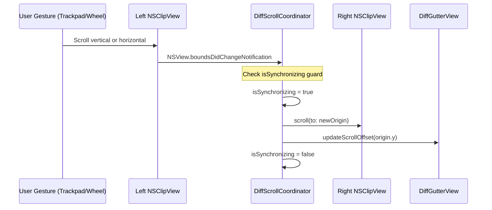

# Technical Design: Visual Diff Editor

## System Design

### 1. Application Lifecycle & Main Window Architecture

The application transitions from a headless accessory status bar tool into a standard native macOS desktop application:

```mermaid
flowchart TD
    AppMain[AppMain.main] --> AppDelegate[AppDelegate]
    AppDelegate --> ActivationPolicy[NSApp.setActivationPolicy(.regular)]
    AppDelegate --> MenuBuilder[Build Standard NSMenu (File, Edit, Find, Window)]
    AppDelegate --> MainWindowController[MainWindowController.showWindow]
    MainWindowController --> Window[NSWindow (Titled, Closable, Miniaturizable, Resizable)]
    Window --> ContentView[DiffContainerView]
```

#### Key Architecture Points:
- **Regular Activation**: In `AppDelegate.applicationDidFinishLaunching`, `NSApp.setActivationPolicy(.regular)` is invoked, ensuring standard Dock presence and menu bar activation.
- **Config & Bundle Settings**: `LS_UI_ELEMENT` in `scripts/config.sh` is set to `false`, allowing the `.app` bundle to run as a standard GUI application.
- **Standard Application Menus**: A programmatic `NSMenu` structure provides essential menu items (`Quit`, `Hide`, `Close`, `Undo`, `Redo`, `Cut`, `Copy`, `Paste`, `Select All`, and `Find` actions) so keybindings (`Cmd+Z`, `Cmd+Shift+Z`, `Cmd+F`, `Cmd+C`, `Cmd+V`, `Cmd+W`) automatically route through the native responder chain to the focused `NSTextView`.
- **Window Management**: `MainWindowController` manages the lifecycle of the primary `NSWindow` (1200x800 default size, minimum 700x400) and owns the root diff container view.

### 2. Two-Pass Diff Engine: Line Hunks & Intra-Line Word Highlights

The diff engine executes in two coordinated passes to compute both macroscopic line alignments and granular word-level changes:

```mermaid
flowchart TD
    subgraph Pass1 [Pass 1: Line Diff & Alignment]
        Split[Tokenize into Lines]
        LCS[CollectionDifference on [String]]
        Hunks[Group Contiguous Hunks]
        Rows[Align GitHub-style Rows with Spacers]
    end

    subgraph Pass2 [Pass 2: Intra-Line Word Diff]
        DetectMod[Identify Modified Line Pairs in Hunks]
        WordTokenize[Tokenize Lines into Words/Whitespace]
        WordDiff[CollectionDifference on Word Tokens]
        CharRanges[Map to Character NSRanges for Highlight]
    end

    Input[Raw Left & Right Text] --> Pass1
    Pass1 --> DetectMod --> Pass2
    Pass2 --> Output[DiffResult with Intra-Line Highlights]
```

#### Core Data Structures:
```swift
public enum DiffLineKind: Equatable {
    case unchanged
    case addition
    case deletion
    case spacer // Visual empty row for alignment
}

public struct WordHighlightSpan: Equatable {
    public let range: NSRange
    public let isEmphasized: Bool
}

public struct AlignedDiffRow: Equatable {
    public let leftLineNumber: Int?
    public let leftText: String?
    public let leftKind: DiffLineKind
    public let leftWordHighlights: [WordHighlightSpan]
    
    public let rightLineNumber: Int?
    public let rightText: String?
    public let rightKind: DiffLineKind
    public let rightWordHighlights: [WordHighlightSpan]
    
    public let hunkIndex: Int?
}

public struct DiffHunk: Equatable {
    public let id: Int
    public let leftLineRange: Range<Int>
    public let rightLineRange: Range<Int>
    public let leftLines: [String]
    public let rightLines: [String]
    public let kind: HunkKind // .addition, .deletion, .modification
}

public struct DiffResult: Equatable {
    public let hunks: [DiffHunk]
    public let alignedRows: [AlignedDiffRow]
    public let additionsCount: Int
    public let deletionsCount: Int
    public var isIdentical: Bool { hunks.isEmpty }
}
```

### 3. AppKit Text Architecture & Clean Buffer Paragraph Spacing

The text editing system uses `NSTextView`, `InvisibilityLayoutManager` (subclassing `NSLayoutManager`), and `NSTextStorage`.

```mermaid
flowchart TD
    Storage[NSTextStorage (Clean Raw User Text)] --> LayoutManager[InvisibilityLayoutManager]
    Container[NSTextContainer] --> TextView[NSTextView (Editable, Monospace)]
    LayoutManager --> Container
    
    subgraph Alignment Pass
        DiffResult[DiffResult] --> ParagraphSpacing[Set paragraphSpacingBefore on Target Lines]
        ParagraphSpacing --> LayoutManager
    end
    
    subgraph Drawing Pass
        LayoutManager --> DrawGlyphs[drawGlyphs: Invisibility Rendering (·, →, ↵)]
        LayoutManager --> DrawBg[drawBackground: Diff Line Tints + Spacer Hash Pattern]
    end
```

#### Why Clean Buffer Paragraph Spacing (Option A):
- **Raw Storage Integrity**: `NSTextStorage` holds strictly the user's actual text. No placeholder or dummy characters are inserted.
- **Natural Native Editing**: Typing, deleting, arrow-key navigation, text selection, and undo/redo (`NSUndoManager`) behave with native AppKit performance and zero offset translation bugs.
- **Visual Alignment via Geometry**: When a diff hunk introduces a gap of $N$ lines, the paragraph attribute `.paragraphSpacingBefore = N * lineHeight` is applied to the subsequent line. In the layout manager's `drawBackground(forGlyphRange:at:)`, the empty gap rectangle is filled with the GitHub-style spacer diagonal hash pattern.

---

### 4. Synchronized Scrolling & Mutual Observation Protocol

To achieve bidirectional scrolling without event loops or rubber-banding jitter, `DiffScrollCoordinator` monitors clip view notifications with a re-entrancy lock:



- **Observation Setup**: Left and right scroll views set `contentView.postsBoundsChangedNotifications = true`.
- **Bidirectional Lock**: A boolean `isSynchronizing` flag suppresses reciprocal notifications.
- **Dual-Axis Panning**: Both `bounds.origin.x` (horizontal) and `bounds.origin.y` (vertical) synchronize in real time.

---

### 5. Middle Gutter Component & Hunk Action Geometry

`DiffGutterView` sits between the left and right scroll views. Its width is fixed at 52 points:

```mermaid
flowchart TD
    Gutter[DiffGutterView (52pt Width)]
    Gutter --> Header[Gutter Header: Copy All Left / Copy All Right Buttons]
    Gutter --> Body[Scrollable Gutter Body]
    Body --> HunkButtons[Per-Hunk Action Buttons (➔, ⬅)]
    Body --> HoverDetector[Mouse Tracking Area (NSTrackingArea)]
    HoverDetector --> Reveal[Reveal Action Buttons on Hover]
```

- **Header Controls**: Fixed toolbar area with `Copy All Right` (`➔➔`) and `Copy All Left` (`⬅⬅`).
- **Hunk Geometry Tracking**: The gutter queries `layoutManager.lineFragmentRect(forGlyphAt:effectiveRange:)` for the starting line of each diff hunk to calculate exact `Y` positions for the per-hunk copy buttons.
- **Hover Activation**: An `NSTrackingArea` detects mouse entry over the gutter or corresponding editor line rows, smoothly revealing the copy buttons.

---

### 6. Things to Consider & Alternative Architecture: Synthetic Spacer Lines (Option B)

> [!NOTE]
> This section documents the alternative **Synthetic Spacer Lines (Option B)** approach for future reference if you decide to transition away from paragraph spacing.

#### Option B Architecture Overview
In Option B, actual newline characters (`\n`) are injected directly into `NSTextStorage` for every missing line in a diff hunk.

#### Implementation Requirements if Migrating to Option B:
1. **Bidirectional Offset Translation Map**:
   - Must maintain an index translation table `ModelIndex <-> DisplayIndex` that maps between clean text positions and synthetic text positions.
   - Every text change in `textStorage` must update this translation map before triggering diff recalculation.
2. **Text View Interceptions (`NSTextViewDelegate`)**:
   - `textView(_:shouldChangeTextInRange:replacementString:)`: Must detect whether `replacementRange` intersects any synthetic spacer line, and either cancel the edit or re-route the insertion to the nearest real line.
   - `textView(_:willChangeSelectionFromCharacterRange:toCharacterRange:)`: Must prevent caret placement in the middle of synthetic spacer rows.
3. **Copy & Paste Sanitization**:
   - Overriding `copy(_:)` and `cut(_:)` in a custom `NSTextView` subclass to filter out synthetic spacer rows before writing plaintext to `NSPasteboard.general`.
4. **File Save / Export**:
   - Stripping all synthetic spacer lines before saving to disk.

#### Tradeoffs Summary:
- *Advantage of Option B*: Caret navigation can visually travel vertically across empty spacer lines line-by-line if desired.
- *Drawback of Option B*: Significantly higher architectural complexity, vulnerability to cursor/selection edge cases, and high maintenance overhead for text mutation delegate methods.

## Program Design

### 1. File Structure & Responsibilities

The implementation organizes files by functional responsibility under `Sources/App/` and adds unit tests under `Tests/AppTests/`:

```text
Sources/App/
├── Main.swift                           # Entry point invoking NSApplication.run()
├── AppDelegate.swift                    # Configures .regular activation policy, main menu, launches MainWindowController
├── AppConfig.swift                      # Application metadata, version, and bundle configuration
├── Controllers/
│   ├── MainWindowController.swift       # Manages NSWindow lifecycle, toolbar controls (stats, invisibles)
│   ├── DiffCoordinator.swift           # Orchestrates 100ms debounced diffing and hunk merge operations
│   └── DiffScrollCoordinator.swift     # Synchronizes bidirectional scrolling between clip views
├── Models/
│   ├── DiffModel.swift                  # Core line Myers diff engine and GitHub-style row alignment
│   ├── WordDiffModel.swift              # Secondary pass intra-line word and whitespace diff engine
│   ├── DiffHunk.swift                   # Data models (DiffHunk, AlignedDiffRow, DiffResult, DiffLineKind)
│   └── DiffTheme.swift                  # Color palette (light/dark adaptive additions, deletions, borders)
└── Views/
    ├── DiffContainerView.swift          # Root split container hosting Left Editor, Gutter, and Right Editor
    ├── DiffEditorView.swift             # NSScrollView + NSTextView + LineNumberRulerView wrapper
    ├── InvisibilityLayoutManager.swift  # NSLayoutManager subclass: renders dim invisibles (·, →, ↵) & spacer gaps
    ├── LineNumberRulerView.swift        # NSRulerView drawing aligned line numbers
    └── DiffGutterView.swift             # Middle separator with header bulk copy & hover hunk action buttons

Tests/AppTests/
├── TestMain.swift                       # Test runner entry point
├── AppTests.swift                       # Existing config tests
├── DiffEngineTests.swift                # Unit tests for line additions, deletions, modifications, identical files
├── WordDiffTests.swift                  # Unit tests for intra-line word tokenization and diff highlights
└── HunkCopyTests.swift                  # Unit tests for bulk copy and individual hunk copy operations
```

---

### 2. Component Tree & State Flow

```text
<MainWindowController> (NSWindowController)
  │  State:
  │    - diffResult: DiffResult
  │    - showsInvisibles: Bool (default: false)
  │    - isSyncingScroll: Bool
  │
  ├── <HeaderToolbarView>
  │     ├── [StatsBadgeView] ("X changes found (+A, -D)" or "files identical")
  │     └── [InvisiblesCheckbox] ("Show Invisibles" -> toggles layoutManager.showsInvisibles)
  │
  └── <DiffContainerView> (HStack layout, fixed window bounds)
        │
        ├── <DiffEditorView: Left (Original)>
        │     ├── <LineNumberRulerView>
        │     └── <InvisibilityLayoutManager>
        │           └── <NSTextView> (Editable, Monospaced, usesFindBar = true)
        │
        ├── <DiffGutterView: Middle Separator> (52pt width)
        │     ├── <GutterHeaderView>
        │     │     ├── [Copy All Right (➔➔)]
        │     │     └── [Copy All Left (⬅⬅)]
        │     └── <GutterBodyView>
        │           └── [Per-Hunk Hover Buttons (➔, ⬅)]
        │
        └── <DiffEditorView: Right (Modified)>
              ├── <LineNumberRulerView>
              ├── <InvisibilityLayoutManager>
              └── <NSTextView> (Editable, Monospaced, usesFindBar = true)
```

---

### 3. Core Component Signatures and Contracts

#### 3.1 DiffEngine (Pure Swift, Zero UI Dependencies)
```swift
public final class DiffEngine {
    /// Computes two-pass diff: line alignments followed by intra-line word differences
    public static func computeDiff(
        leftText: String,
        rightText: String,
        includeWordDiff: Bool = true
    ) -> DiffResult

    /// Applies a hunk replacement from source text into target text, returning new target text
    public static func applyHunk(
        _ hunk: DiffHunk,
        from sourceText: String,
        into targetText: String,
        direction: MergeDirection
    ) -> String
}

public enum MergeDirection {
    case leftToRight
    case rightToLeft
}
```

#### 3.2 DiffCoordinator
```swift
public final class DiffCoordinator: NSObject, NSTextStorageDelegate {
    public private(set) var diffResult: DiffResult
    public var onDiffUpdated: ((DiffResult) -> Void)?
    
    private var debounceTimer: Timer?
    private let debounceInterval: TimeInterval = 0.10 // 100ms
    
    public init(leftTextView: NSTextView, rightTextView: NSTextView)
    
    public func scheduleDiffRecalculation()
    public func executeCopyAll(from source: EditorSide, to target: EditorSide)
    public func executeCopyHunk(_ hunk: DiffHunk, from source: EditorSide, to target: EditorSide)
}

public enum EditorSide {
    case left
    case right
}
```

#### 3.3 InvisibilityLayoutManager
```swift
public final class InvisibilityLayoutManager: NSLayoutManager {
    public var showsInvisibles: Bool = false {
        didSet { firstTextView?.needsDisplay = true }
    }
    
    /// Spacers and line highlight metadata provided by DiffCoordinator
    public var spacerGaps: [Int: CGFloat] = [:] // lineIndex -> vertical gap height
    public var lineBackgroundTints: [Int: NSColor] = [:]
    public var wordHighlights: [NSRange: NSColor] = [:]
    
    public override func drawGlyphs(forGlyphRange glyphsToShow: NSRange, at origin: NSPoint) {
        super.drawGlyphs(forGlyphRange: glyphsToShow, at: origin)
        guard showsInvisibles else { return }
        drawInvisibleCharacters(forGlyphRange: glyphsToShow, at: origin)
    }
    
    public override func drawBackground(forGlyphRange glyphsToShow: NSRange, at origin: NSPoint) {
        super.drawBackground(forGlyphRange: glyphsToShow, at: origin)
        drawDiffBackgroundsAndSpacers(forGlyphRange: glyphsToShow, at: origin)
    }
}
```

#### 3.4 DiffScrollCoordinator
```swift
public final class DiffScrollCoordinator: NSObject {
    private weak var leftScrollView: NSScrollView?
    private weak var rightScrollView: NSScrollView?
    private weak var gutterView: DiffGutterView?
    private var isSynchronizing = false
    
    public func attach(left: NSScrollView, right: NSScrollView, gutter: DiffGutterView) {
        self.leftScrollView = left
        self.rightScrollView = right
        self.gutterView = gutter
        
        left.contentView.postsBoundsChangedNotifications = true
        right.contentView.postsBoundsChangedNotifications = true
        
        NotificationCenter.default.addObserver(
            self,
            selector: #selector(clipViewDidScroll(_:)),
            name: NSView.boundsDidChangeNotification,
            object: nil
        )
    }
    
    @objc private func clipViewDidScroll(_ notification: Notification) {
        guard !isSynchronizing,
              let clipView = notification.object as? NSClipView,
              let targetScrollView = (clipView == leftScrollView?.contentView) ? rightScrollView : leftScrollView,
              let otherClipView = targetScrollView.contentView else { return }
        
        isSynchronizing = true
        defer { isSynchronizing = false }
        
        let newOrigin = clipView.bounds.origin
        otherClipView.scroll(to: newOrigin)
        targetScrollView.reflectScrolledClipView(otherClipView)
        gutterView?.updateVerticalOffset(newOrigin.y)
    }
}
```

---

### 4. Application Startup Call Tree

```text
AppMain.main()
  └── NSApplication.shared.run()
        └── AppDelegate.applicationDidFinishLaunching()
              ├── NSApp.setActivationPolicy(.regular)
              ├── MenuBuilder.setupMainMenu() (App, File, Edit, Find, View, Window)
              ├── MainWindowController.init()
              │     ├── NSWindow.init(contentRect: 1200x800, styleMask: titled|closable|miniaturizable|resizable)
              │     ├── DiffContainerView.init()
              │     │     ├── LeftEditor: DiffEditorView
              │     │     ├── MiddleGutter: DiffGutterView
              │     │     └── RightEditor: DiffEditorView
              │     ├── DiffCoordinator.init(left, right)
              │     │     └── schedule initial diff
              │     └── DiffScrollCoordinator.attach(left, right, gutter)
              └── MainWindowController.showWindow(self)
```

---

## Patterns to Follow

### 1. Pure Model Separation for Testing Seams
All diffing, hunk calculation, line alignment, intra-line word diffs, and text copy mutations are implemented as pure functions in `DiffEngine` and `WordDiffEngine`.
- **Test Seam**: Can be verified 100% headlessly in `make test` without initializing AppKit windows or views.
- **Example**:
```swift
// Tests/AppTests/DiffEngineTests.swift
let left = "func add() {\n    return 1\n}"
let right = "func add() {\n    return 2\n}"
let result = DiffEngine.computeDiff(leftText: left, rightText: right)
assert(result.hunks.count == 1)
assert(result.hunks[0].kind == .modification)
```

### 2. AppKit Appearance Observation & Dynamic Colors
Adopt the established pattern in `StatusBarController.swift:31-47` using `NSColor(name:dynamicProvider:)` or appearance observation:
- Colors dynamically resolve to high-contrast pastel tints in Aqua (light mode) and deep subdued accents in DarkAqua (dark mode).
- Example:
```swift
public enum DiffTheme {
    public static var additionBackground: NSColor {
        NSColor(name: nil) { appearance in
            appearance.bestMatch(from: [.darkAqua, .aqua]) == .darkAqua
                ? NSColor(red: 46/255, green: 160/255, blue: 67/255, alpha: 0.22)
                : NSColor(red: 46/255, green: 160/255, blue: 67/255, alpha: 0.15)
        }
    }
}
```

### 3. Build & Test Compatibility
- Retain zero external package dependencies in `Package.swift`.
- Both `scripts/build.sh` and `scripts/test.sh` use `swiftc` directly, picking up all `.swift` files under `Sources/App/` automatically via `find Sources/App -type f -name "*.swift"`.

---

## Scope

### In Scope
- Full desktop GUI app with `.regular` activation policy and programmatic application menu.
- Dual editable `NSTextView` panes with line numbers, monospace font, and native per-pane find/replace.
- Two-pass diff engine (line-level Myers diffing + intra-line word diffing).
- GitHub-style split row alignment via clean text buffer paragraph spacing.
- Synchronized bidirectional scrolling with re-entrancy protection.
- Middle gutter with global copy-all header buttons and hover-revealed per-hunk copy arrows.
- Dynamic change statistics badge ("files identical" on synchronization).
- Invisibility characters toggle rendering dim middle dots, arrows, and returns.
- Comprehensive native test suite covering all diff and merge cases.

### Out of Scope
- Direct Git branch / repository integration (standalone text & file diff focus).
- 3-way merge conflict editor.
- Language-specific syntax tokenizers (standard diff coloring is primary).

